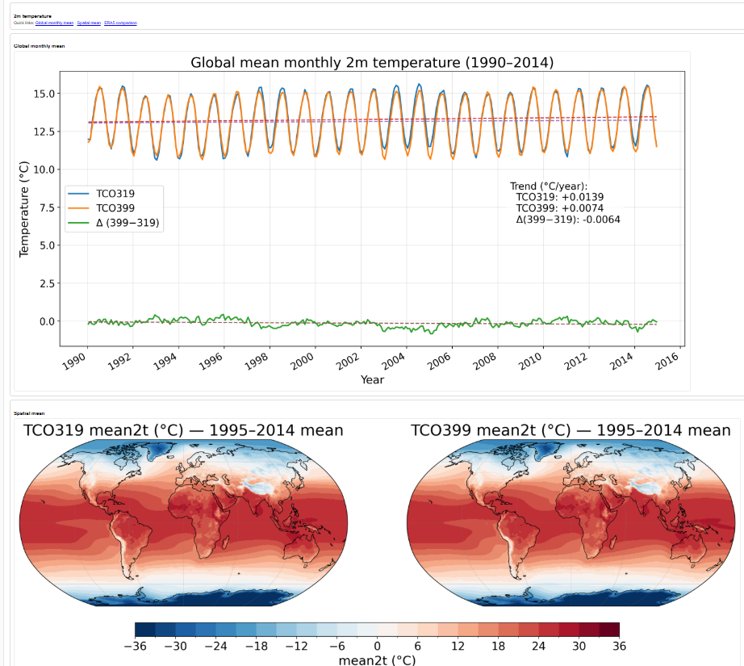

# Climate Model Evaluation Dashboard

An interactive dashboard for exploring and comparing high-resolution climate model simulations against ERA5 reanalysis for different resolutions.

The dashboard demonstrates workflows developed for climate model evaluation using Python and HPC environments.

## Live Dashboard

https://tunahim.github.io/MRana-dashboard/

## Features

- Interactive climate dashboard
- Multi-model comparison
- ERA5 evaluation
- Performance statistics
- Global temperature, sea ice and precipitation diagnostics

## Key technologies

- Python
- xarray
- Dask
- HEALPix
- GRIB
- ERA5
- Cartopy
- Matplotlib
- Climate model evaluation
- HPC workflows
- Windsurf AI

## Repository contents

- Dashboard HTML pages
- Python analysis scripts
- Jupyter notebooks
- Example figures

## Notes

- The original simulation data are not included because they are hosted on HPC systems and are not publicly distributable.
- The dashboard is intended as a demonstration of climate model evaluation workflows, visualisation, and software engineering practices.
- The analysis was developed and tested in HPC environments using Python, xarray, Dask, and related scientific libraries.
